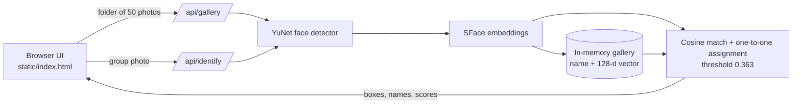

# Architecture

> TODO: generate the required diagram with Archify. Tell your AI agent:
> "Install Archify for me by reading https://raw.githubusercontent.com/tt-a1i/archify/main/llms.txt", then "diagram this project".
> Save the export as `docs/architecture.png` and embed it below. The Mermaid sketch is a placeholder.

## Trade-offs
- **Chose** OpenCV YuNet+SFace. **Gave up** some accuracy vs InsightFace/ArcFace on small, blurry or side-on faces. **Why:** installs with one pip command, ~40 MB, CPU-only, so it is safe on an unseen laptop.
- **Chose** in-memory gallery. **Gave up** persistence; reloading the folder takes seconds for 50 people. **Why:** no database, nothing to break.
- **Chose** one-to-one assignment (a person can match only one face). **Gave up** handling a genuine duplicate. **Why:** prevents two faces being given the same name.
- **Chose** Flask + one HTML file with no CDN. **Gave up** a JS framework. **Why:** must work with no internet.
