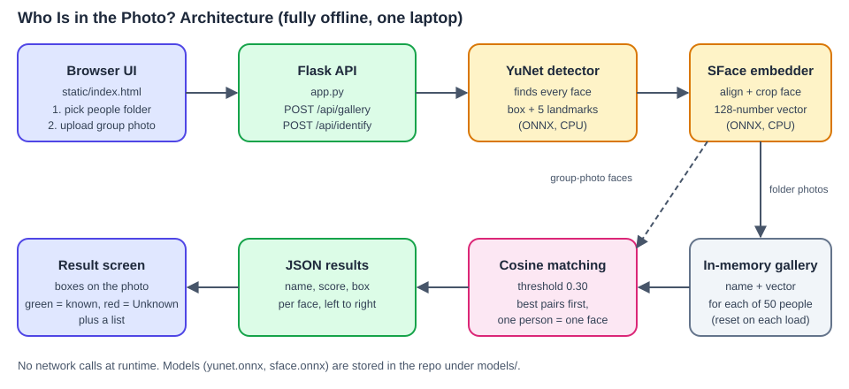

# Architecture

## How it works
1. **Load the people folder.** The browser sends the 50 photos to `POST /api/gallery`. YuNet finds the face in each photo (the largest one is used), SFace turns it into a 128-number vector, and the app keeps the name (from the file name) and vector in memory.
2. **Upload the group photo.** The browser sends it to `POST /api/identify`. YuNet finds every face and SFace makes a vector for each.
3. **Match.** Each face is compared with all stored vectors using cosine similarity. A match must score at least **0.30**. The best-scoring pairs are assigned first, so one person is never named on two faces.
4. **Show.** The server returns name, score and box for each face. The page draws green boxes for known people and red "Unknown" boxes, and lists the same results beside the photo.

Everything runs locally on CPU. There are no network calls at runtime, and the two ONNX models are stored in `models/`.

## About the diagram tool
The brief asks for the diagram to be made with Archify. I tried it and it did not work on my Windows laptop:
- Archify installed correctly (version 3.2.0 on the first try, 3.3.0 on the second) and its `doctor` check passed.
- Both times diagram generation stopped at Archify's final output-safety step, before an HTML file was produced. The first error was a file-identity mismatch reported by Node; the second was `finalize-receipt-changed-during-inspection`.
- The AI agent (GitHub Copilot) stopped and reported the exact error instead of retrying. The chat screenshots are in `docs/archify_attempt.png`.
- The diagram above is therefore a hand-written SVG (`docs/architecture.svg`), written with AI help, and is **not** an Archify output.

## Trade-offs
- **Chose YuNet + SFace.** Gave up some accuracy versus larger models such as InsightFace ArcFace on small, blurry or side-on faces. Why: one `pip install`, about 40 MB of models, CPU-only, and safe to run on an unseen laptop.
- **Chose an in-memory gallery.** Gave up saving the folder between runs. Why: loading 50 photos takes seconds, and there is no database to break.
- **Chose one threshold (0.30) plus one-to-one assignment.** Gave up per-person tuning, and a very low threshold can name a stranger. Why: the demo includes people who are not in the folder, and this was the value that separated them best on my tests.
- **Chose Flask plus one HTML file with no CDN.** Gave up a JavaScript framework. Why: it must work with no internet, and office staff need one simple screen.
- **Chose one face per folder photo (the largest).** Gave up photos where two people are in the same file. Why: the brief says each file is one named person.
